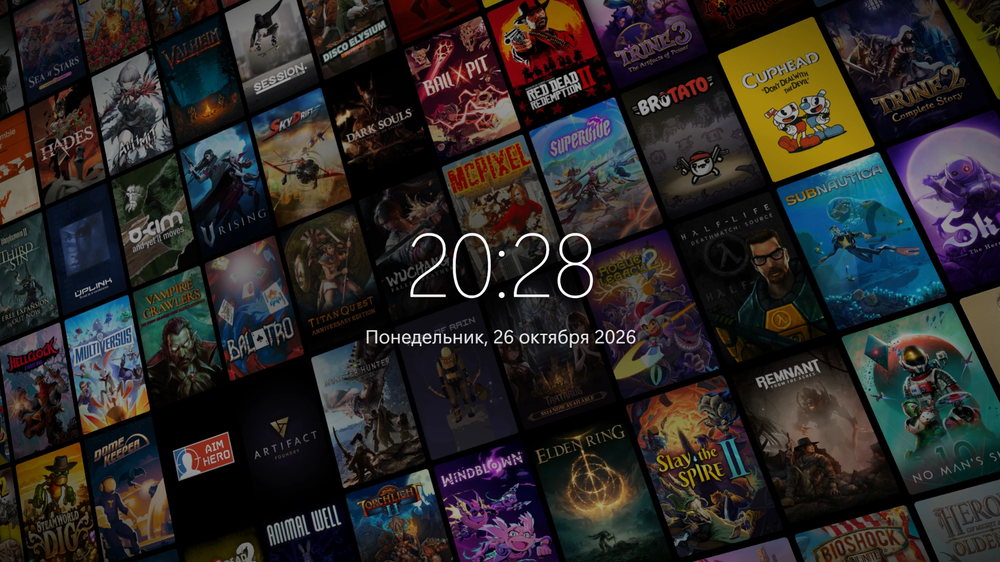

# SteamGameWall

A custom screensaver for **Steam Big Picture** (Windows): an endless, slowly drifting wall of
cover art from *your own* Steam library, tilted in 3D like the Netflix poster wall, with a large
clock and date in the centre.



- Infinite seamless scroll on a single tilted plane (WebGL2, one instanced draw call, ~60 FPS)
- Covers come from your whole library, not just installed games; a persistent shuffled deck
  keeps consecutive runs from repeating the same games, and the same cover never appears twice on screen
- Fully offline after the first sync — covers are cached locally, start-up is near-instant
- Any resolution and aspect ratio (16:9, 16:10, 21:9…) without stretching
- Everything is tunable in `config.json`

## Requirements

- Windows 10/11, Steam client with custom screensaver support (October 2026 update or newer)
- Windows PowerShell 5.1 (built in)

## Install

```powershell
git clone https://github.com/KFarbiazh/SteamGameWall.git
cd SteamGameWall
powershell -ExecutionPolicy Bypass -File tools\install.ps1
```

`install.ps1` copies the screensaver to `Steam\config\uioverrides\screensavers\steam-game-wall`
and builds the cover cache there. Then in Big Picture:
**Settings → Customization → Screensaver → `steam-game-wall`** (use *Preview* to try it).

Keep the cache fresh when you buy new games — re-run the sync manually, or register a
scheduled task (at logon + daily at 04:00):

```powershell
powershell -ExecutionPolicy Bypass -File "<Steam>\config\uioverrides\screensavers\steam-game-wall\tools\library-sync.ps1" -InstallTask
```

## How the library is found

No login or API key is needed. `tools/library-sync.ps1` reads Steam's local PICS cache:
`appcache/packageinfo.vdf` lists your licensed packages and `appcache/appinfo.vdf` provides
each app's type, name and portrait art path (`tools/SteamPics.cs` is a small binary-VDF reader).
Only `Game` apps are kept; tools, demos, DLC, soundtracks and games without real portrait art
are skipped (for those Steam only has an auto-generated cover — the wide header pasted over
a blur — which looks wrong on the wall).

Covers are downloaded once (600×900) from the Steam CDN, falling back to Steam's local
`librarycache`.

Optional keys in `config.json → library`:

| Key | Effect |
| --- | --- |
| `steamApiKey` | [Steam Web API key](https://steamcommunity.com/dev/apikey): also merges `GetOwnedGames`, catching games this PC's Steam never loaded |
| `steamGridDbKey` | [SteamGridDB key](https://www.steamgriddb.com/profile/preferences/api): fallback source when the Steam CDN has no cover |

## Configuration

Edit `config.json` in the **installed** folder (re-running `install.ps1` keeps it;
use `-OverwriteConfig` to reset it).

| Section | Keys |
| --- | --- |
| `wall` | `postersOnScreen`, `gapPx`, `cornerRadiusPx` |
| `camera` | `perspectivePx`, `rotateXDeg`, `rotateYDeg`, `rotateZDeg`, `scale`, `zoomAmplitude`, `zoomPeriodSec` |
| `motion` | `speedPxPerSec` (1080p-equivalent pixels), `directionDeg` |
| `overlay` | `dim`, `centerShade`, `vignette` |
| `clock` | `locale`, `hour12`, `timeSizeVh`, `dateSizeVh`, `offsetYVh`, `fontWeight`, `dateFormat` (`{weekday}`, `{day}`, `{month}`, `{year}`) |
| `selection` | `avoidRepeatsAcrossRuns`, `excludeAppIds`, `excludeNamePatterns` (regex) |
| `performance` | `maxFps`, `textureWidth` (0 = auto), `textureBudgetMB`, `renderScale` |
| `library` | `includeTypes`, `steamApiKey`, `steamGridDbKey`, `maxCacheMB` |

## How Steam loads it

Each folder in `Steam/config/uioverrides/screensavers/<name>` becomes a screensaver with id
`uioverride-<name>`, opened in its own browser view at
`https://uioverride-<name>.steamscreensavers.host/index.html` (mapped to the folder).
Steam blocks input to the page and closes the screensaver on any activity itself.

## Layout

```
index.html, styles.css, app.js   the screensaver
config.json                      settings shared by the page and the sync script
tools/library-sync.ps1           library + cover cache sync
tools/SteamPics.cs               appinfo.vdf / packageinfo.vdf reader
tools/install.ps1                copy into Steam and sync
cache/                           generated: games.json, games.js, covers/ (not in git)
```
